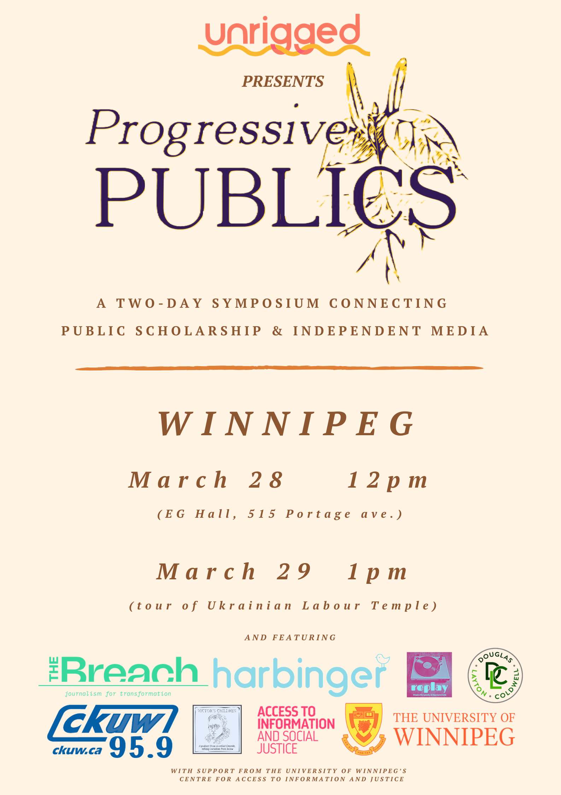

À une époque marquée par des crises multiples et qui s’intensifient, **Progressive Publics** est une série nationale de symposiums qui mettent en relation le milieu universitaire, l’activisme et les médias indépendants. Ces symposiums sont ancrés dans un engagement envers la justice sociale et affirment que tant l’université que les médias constituent des biens publics ayant des rôles essentiels et étroitement liés dans l’analyse critique ainsi que dans la mobilisation et la diffusion des connaissances.

Le samedi 28 mars, le symposium **Progressive Publics** de Winnipeg sera animé par la journaliste et militante Emily Leedham, le Dr Kevin Walby (Centre for Access to Information and Justice de l’Université de Winnipeg), le journaliste Jeremy Appel, la Dre Roberta Lexier (Mount Royal University), Andre Goulet (Harbinger/Unrigged) et d’autres encore. L’événement proposera des entrevues et des panels réunissant des universitaires et des médias indépendants autour de thèmes tels que le négationnisme des pensionnats autochtones, l’histoire du mouvement ouvrier, le passé et l’avenir du NPD, la justice carcérale, et bien d’autres sujets.
