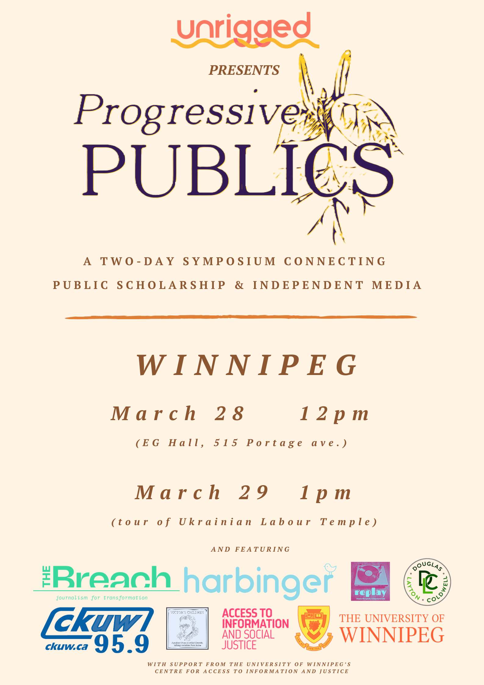

<!--  -->
<!-- The Progressive Publics Symposium 2026 will take place in Winnipeg on March 28-29th. -->

In a time of multiple and intensifying crises, **Progressive Publics** is a national series of Syposiums connecting academia, activism and independent media.  These symposiums are rooted in a commitment to social justice and assert that both the academy and the media are public goods that have crucial and entwined roles to play in critical analysis and knowledge mobilization and dissemination.

On Saturday, March 28th the Winnipeg **Progressive Publics** Symposium will be hosted by journalist and activist Emily Leedham, Dr. Kevin Walby (University of Winnipeg’s Centre for Access to Information and Justice), journalist Jeremy Appel, Dr. Roberta Lexier (Mount Royal University), Andre Goulet (Harbinger/Unrigged) and others and featuring interviews and panels with academics and independent media on topics like residential school denialism, labour history, the past and future of the NDP, carceral justice and more.
